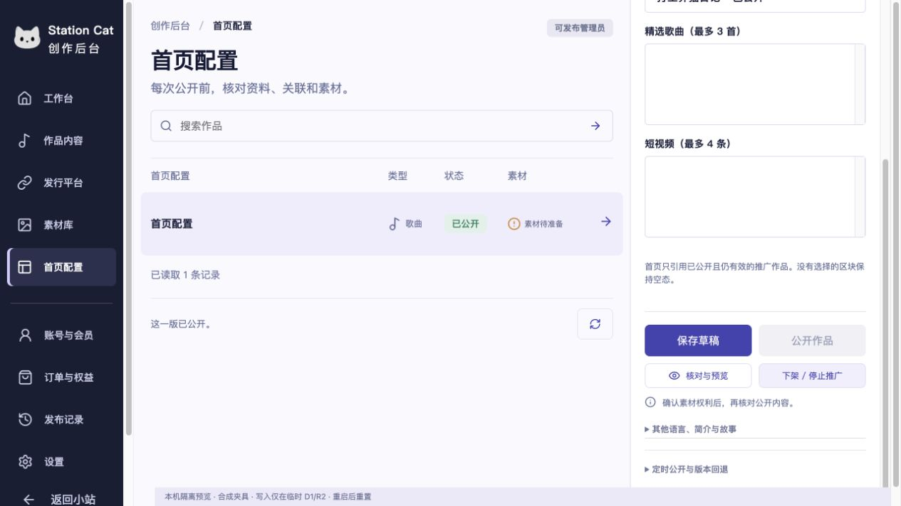

# L12 · 移除手动操作说明

根据用户要求，创作后台移除“本次操作说明”的折叠入口、输入框、提示、必填检查及相关样式。首页、歌曲、推广、游戏和视频共用的作品编辑器，以及素材权利登记均不再显示该输入项；保存、公开、下架、定时、取消定时、回退和登记外部视频发布记录不再发送手动说明。

内容接口允许省略 `reason`，不会自动补写一段说明。操作人、时间、动作、目标对象和版本仍由现有事务记录。为兼容尚未刷新的旧页面和未完成操作的原始请求，接口继续校验并接受原有合法 `reason`；历史日志不修改。素材的授权依据、管理员权限、版本冲突、幂等恢复与发布前资源校验保持原有合同，无数据库迁移。

验证：后台专项 75 项、staging 22 项全部通过；品牌与游戏首发候选构建通过（60 个保留 HTML、426 个文件，未使用空正文选项）。专项覆盖不含说明的实际 Worker/D1/R2 创建、保存、权利登记、公开、下架和视频发布登记，以及首页定时、取消定时、回退、幂等重试与自动操作日志。

本机浏览器在临时 D1/R2 中完成“选择游戏 → 保存草稿 → 核对与预览 → 公开作品”，显示“这一版已公开”，没有说明字段和控制台错误。该结果仅为本机夹具验收，未修改生产内容或部署。

[浏览器验收记录](evidence/L12/browser-verification.json)。托管 CI 以本 PR 当前提交的 GitHub 结果为准。
