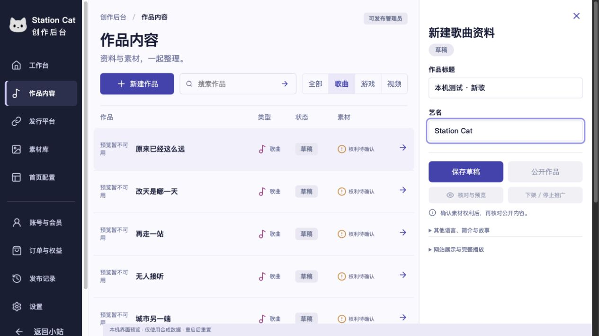
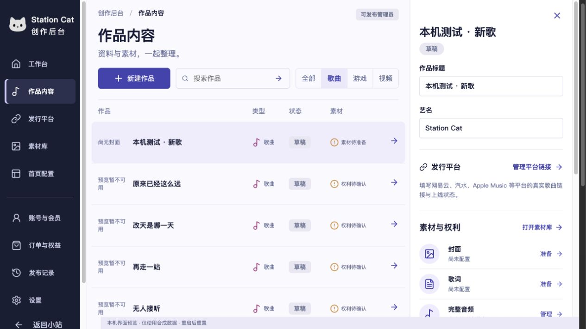

# 新建歌曲自动生成地址

新建歌曲的首屏只需填写作品标题和艺名。地址输入框默认隐藏，提交也不再携带手动 slug。服务端在创建新歌曲时使用 `track-<歌曲 UUID>` 作为地址，同时登记旧音乐记录和网站规范路由。

中文、英文或同名歌曲都不需要手动转换网址。编辑歌名不会重新生成地址；重复提交、并发重试和回执丢失沿用现有幂等记录。已有歌曲及其规范路由保持不变。旧客户端明确提供的地址继续按原规则校验，游戏介绍仍使用原有地址规则。

## 验证

- `npm run test:redesign:content-admin`：117 项通过，含新增地址、同名歌曲、改名稳定、回执丢失、并发重试、实际表单提交和原 Worker / 临时 D1 的回归。
- `npm run test:music:staging`：22 项通过。
- `npm run build:station:first-launch`：通过，60 个 HTML、426 个资源；未使用空正文开发选项。
- 本机浏览器在合成数据预览中只填写「本机测试 · 新歌」和「Station Cat」，保存成功。只读回查得到 `track-bd4a414f-39c2-4980-a8c5-cb748df8718d`，状态为草稿。

截图为本机预览。列表中的封面回退提示来自既有夹具；本次仅验证新建表单与地址保存，不代表生产素材、真机或 VoiceOver 验收。未执行生产部署、迁移、发布或生产内容写入。
