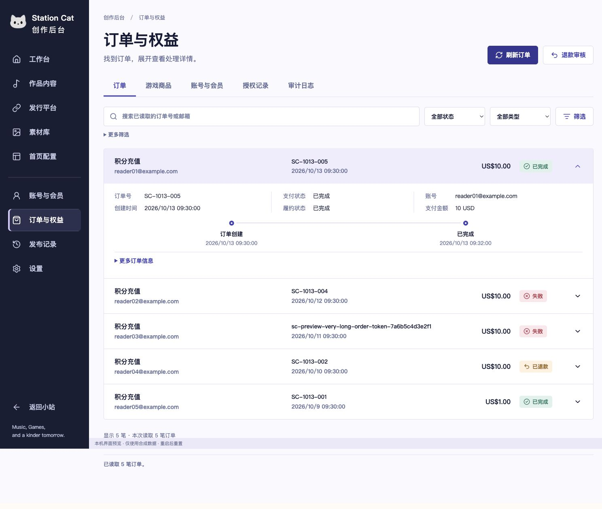
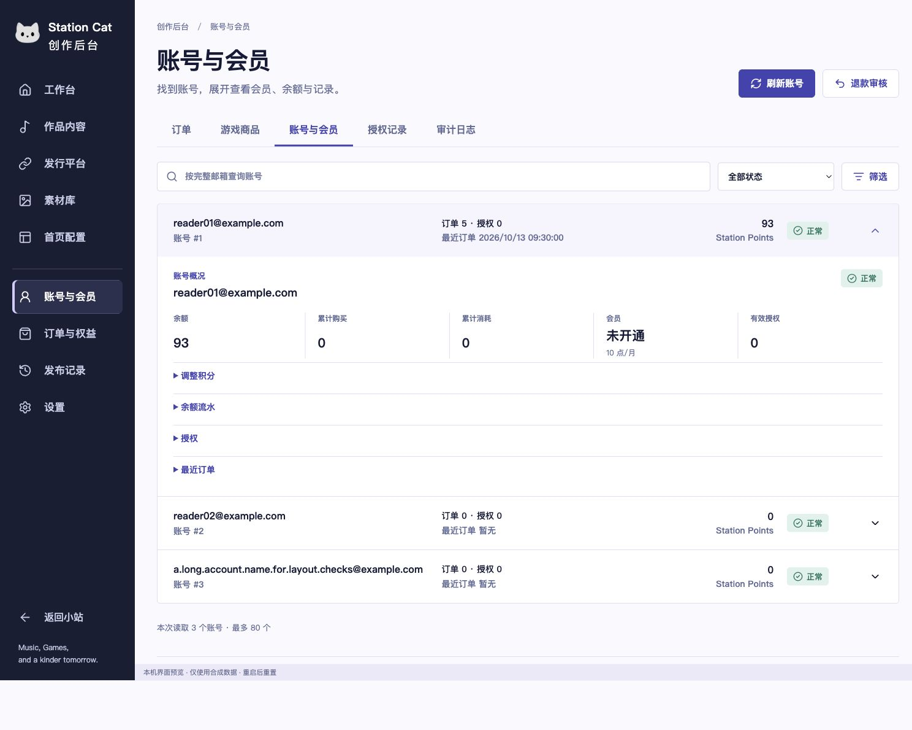
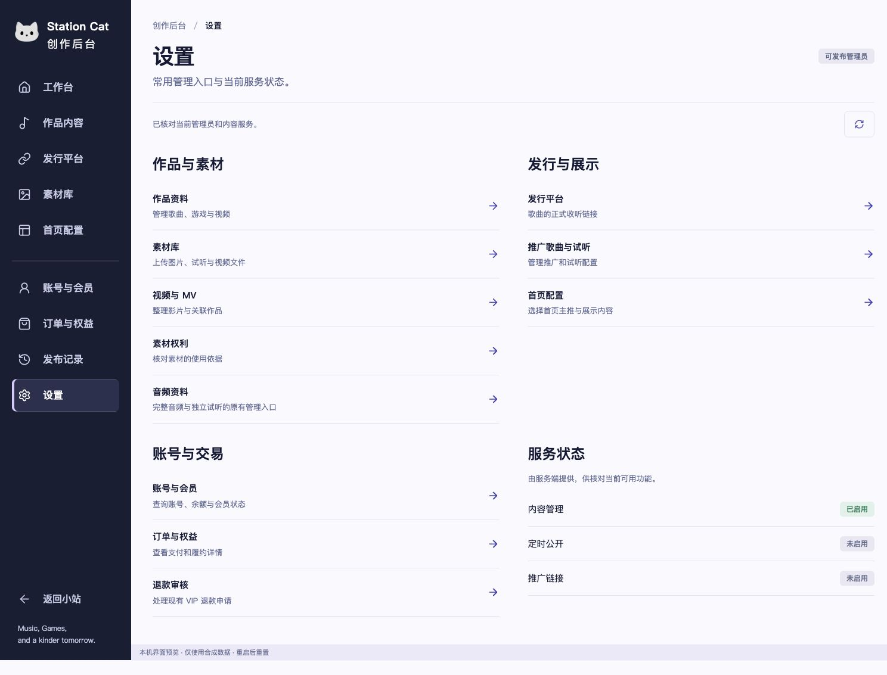

# 服务后台第三方案落地

2026-10-13。基线 `04d02d4946b5ae7dd5f987cc9a2202873ecbf198`，范围为账号、订单与设置三个已有后台页面。用户选择第三方案后实施；本批交付代码与本机预览，尚未合并或部署。

## 最终行为

账号和订单使用横向标签、筛选与行内展开详情，替换双侧栏和窄列表；长邮箱、订单号在窄屏换行。订单支付事件按接口实际返回值显示，原支付链接、人工履约、退款入口及更多排查信息保留。账号概况、余额流水、授权、最近订单与手动积分调整仍可访问，调整原因仍必填。

列表刷新保留已展开的详情节点及未提交账号输入。切换不同账号时确认丢弃；迟到或对象不匹配的详情不能覆盖当前选择。详情失败后可收起再展开重试。顶部刷新重新读取干净的展开详情；有未提交账号输入时保留输入。提交期间防止再次提交及切换对象。

设置分为作品与素材、发行与展示、账号与交易、服务状态，原有 11 个管理目标地址保留。服务状态来自已核对的内容服务响应，只读展示。未调整后端接口、D1 schema、Access、权限和生产开关；已退休的后台内容仍保持隐藏并受原标签白名单限制。

订单搜索只筛选当前读取的最多 80 条；历史记录仍通过已有邮箱、状态、类型等服务端筛选读取。没有新增全库模糊搜索，也没有把旧小说购买变成音乐 VIP。

## 复验

```sh
npm run test:redesign:content-admin
npm run test:music:staging
node scripts/test-admin-v2-workspace.mjs
node scripts/test-cat-life-commerce-admin.mjs
node scripts/test-station-points.mjs
node scripts/test-creem-payments.mjs
npm run build:station:first-launch
node scripts/build-music-staging-assets.mjs
node scripts/check-music-staging-assets.mjs
node scripts/serve-station-admin-preview.mjs --services
```

本机预览地址：`http://127.0.0.1:4236/admin-v2/services/#commerce`、`#accounts`、`http://127.0.0.1:4236/admin-v2/?view=settings`。服务仅监听 loopback，精确本机路由使用内存合成夹具；不读取生产账号/订单、不转发支付请求，重启恢复初始数据。现有临时内容库为设置响应提供合成管理员状态。

验证：内容后台 109 项（含 9 项新服务工作区回归）、staging 22 项全部通过；旧后台结构、游戏商品管理、Station Points 和 Creem 回归通过。首发候选构建未使用空正文开关，通过，60 个 HTML、426 个文件；隔离 staging 为 8 页和 40 个精确依赖，生成与检查通过。日志在 [service-ui-evidence/logs](service-ui-evidence/logs)，仅移除了行尾空白。最终仅 CSS 悬停/焦点修订后重跑构建与资源检查，功能测试记录对应相同功能源码。

设计比较、移动端、长内容及键盘核对见根目录 [design-qa.md](../../design-qa.md)。截图使用合成内容；没有生产订单、真机、VoiceOver 或云存档验收。完整托管 CI 需由本 PR 的提交单独确认。






